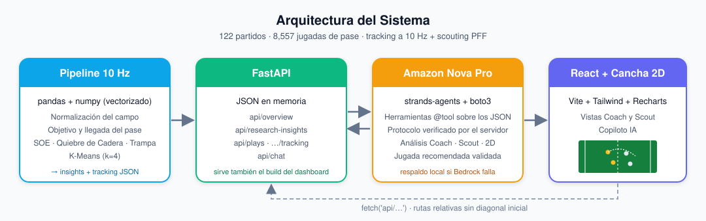

# Hackathon UNAM: Analítica táctica NFL para Coaches y Scouts

## 1. Descripción del Proyecto

Plataforma de análisis táctico para **coordinadores y evaluadores de talento de la NFL**. Toma los datos del NFL Big Data Bowl 2023: 122 partidos de las semanas 1 a 8 de la temporada 2021, con **8,557 jugadas de pase**, tracking de los 22 jugadores y el balón a **10 Hz** y el scouting de Pro Football Focus (PFF). Normaliza todas las jugadas para que la ofensiva ataque hacia la derecha y responde dos preguntas: qué ajuste de esquema debe ordenar el coordinador y qué revela el tracking individual de cada jugador. Un agente con Amazon Nova redacta el análisis y recomienda una jugada real para verla en el reproductor 2D.

El análisis se apoya en tres métricas propias y un hallazgo de gestión de bolsa:

- **Trampa de Presión (Checkdown Trap):** jugadas con presión PFF en las que el receptor tenía más de 3.5 yd de separación y aun así no se logró el primer down. Ocurre en el 18.5% de las jugadas presionadas, y bajo presión las yardas caen de 8.15 a 3.94 por jugada.
- **Separación Sobre lo Esperado (`SOE`):** separación del receptor objetivo en la llegada del balón, menos la media de su cobertura y zona del campo. Se reporta por separado para WR/TE y para RB/FB.
- **Quiebre de Cadera (`|o - dir|`):** máxima diferencia entre la orientación y la dirección de carrera del defensor en cobertura. Se evalúa en cobertura Man junto a la separación que el defensor permite, para distinguir una recuperación élite de una debilidad.
- **Acantilado de 4 segundos en la bolsa:** si el quarterback lanza después de 4.0 s, la presión llega al 71.6%; lanzando en 2.0 s o menos es del 12.0%.

## 2. Arquitectura y Stack Tecnológico



| Capa | Tecnología | Qué hace |
|---|---|---|
| Pipeline de datos | `pandas` 2.2.3 + `numpy` 2.1.3 (`scripts/01_analisis_y_clustering.py`) | Valida llaves, normaliza el campo, identifica receptor objetivo y llegada del pase, calcula métricas, K-Means en `numpy` y exporta `data/insights_partido.json` y `data/featured_plays_tracking.json` (~37 s) |
| Backend | FastAPI 0.115.14 + Uvicorn 0.34.3 (`backend/`) | Sirve los JSON en memoria bajo `/api/...` y el build del dashboard en la misma URL |
| Agente IA | Amazon Nova Pro (`us.amazon.nova-pro-v1:0`) vía `strands-agents` 1.64.0 y `boto3` 1.44.0 (`backend/agent.py`) | Analista Coach/Scout con herramientas `@tool` sobre los JSON; el servidor verifica qué herramientas usó. Si Bedrock no responde, usa un **respaldo local automático** con el mismo formato |
| Frontend | React 18.3.1 + Vite 5.4.21 + TypeScript + Tailwind CSS 3.4.19 + Recharts 3.10.1 (`dashboard/`) | Vistas Coach y Scout, gráficas de reglas y rankings, panel del agente y **reproductor táctico 2D** de jugadas |

Documentación técnica: `docs/reporte_arquitectura_datos.md` (análisis de datos) y `docs/api_esquema.md` (contrato de la API).

## 3. Variables de Entorno (Seguridad)

Crea un archivo `.env` en la raíz del proyecto. Ya está en `.gitignore` y la entrega nunca lo incluye. En el despliegue, AWS usa su propio rol y no se necesitan llaves.

```env
AWS_ACCESS_KEY_ID=tu_access_key_id
AWS_SECRET_ACCESS_KEY=tu_secret_access_key
AWS_SESSION_TOKEN=tu_session_token
AWS_REGION=us-east-1
```

Nunca escribas llaves en el código ni en este README. Sin credenciales, la app funciona igual y el chat responde con el respaldo local.

## 4. Guía Rápida de Despliegue y Ejecución Local

**a) Instalar dependencias.** El instalador del evento deja Python 3.12.12, `.venv`, Node 22.23.1 y `node_modules` dentro del proyecto, con las versiones fijas de `.hackathon/requirements.txt` y `dashboard/package-lock.json`:

```bash
# macOS / Linux
sh .hackathon/setup.sh

# Windows (PowerShell; en CMD omite el .\ inicial)
.\.hackathon\setup.cmd
```

**b) Ejecutar el pipeline de datos** (~37 s; regenera los JSON de `data/` y el reporte de `docs/`):

```bash
# macOS / Linux
.venv/bin/python scripts/01_analisis_y_clustering.py

# Windows
.venv\Scripts\python scripts\01_analisis_y_clustering.py
```

**c) Levantar Backend y Frontend** en dos terminales:

```bash
# Terminal 1: API en http://localhost:8000 (Windows: .venv\Scripts\uvicorn)
.venv/bin/uvicorn backend.main:app --reload --port 8000

# Terminal 2: dashboard en http://localhost:5173 (Vite envía /api al puerto 8000)
cd dashboard
npm ci
npm run dev
```

Abre `http://localhost:5173` (usa `localhost`, no `127.0.0.1`). Para validar y generar la entrega: `sh .hackathon/setup.sh --check` y `sh .hackathon/setup.sh --entregar` (Windows: `.\.hackathon\setup.cmd --check` / `--entregar`).

## 5. Endpoints Principales de la API

| Método y ruta | Devuelve |
|---|---|
| `GET /api/overview` | KPIs globales, distribución de coberturas y formaciones, curva de tiempo en la bolsa y reglas por cobertura, formación, play action y tramo de bolsa |
| `GET /api/research-insights` | 4 clusters tácticos, rankings de `SOE` (WR/TE y RB/FB) y de quiebre de cadera en Man con separación permitida, y estadísticas de la Trampa de Presión |
| `GET /api/plays` | 60 jugadas destacadas con sus métricas; filtros `cluster_id`, `coverage`, `team` y `tag` (`trampa_presion`, `explosiva`, `soe`, `hip_flip`) |
| `GET /api/plays/{game_id}/{play_id}/tracking` | Frames de la jugada (x, y, o, dir, s, rol PFF) para el reproductor 2D |
| `POST /api/chat` | `{"message", "mode": "coach" \| "scout"}` → análisis en tres bloques (Coach, Scout, Tracking 2D) y `recommended_play` |

`GET /health` responde `{"status": "ok"}`. Desde el dashboard, las rutas se llaman sin diagonal inicial: `fetch('api/overview')`.
